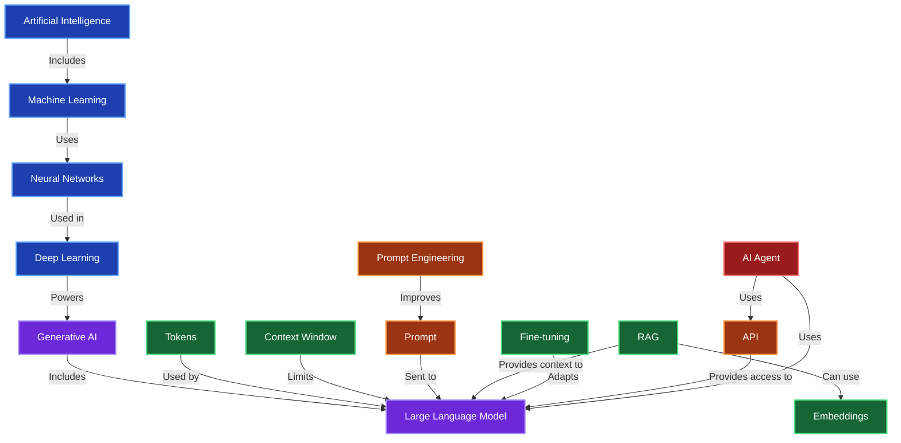

# Generative AI — Relationships Between Terms

**Author:** Anton Danchev  
**Course:** EPAM Tech Orda — GenAI Master Program  
**Date:** November 2026

This diagram shows how the main GenAI concepts
are connected to each other.

## Diagram Description

The diagram shows the relationships between different
AI technologies and concepts.

Artificial Intelligence includes Machine Learning.
Machine Learning can use neural networks, and
Deep Learning uses neural networks with many layers.

Generative AI uses deep learning technologies
to create new content. Large Language Models
are one type of Generative AI.

Language models process text using tokens.
The context window limits how much information
a model can process at one time.

Prompt Engineering helps users write better prompts
to get more accurate and useful responses.

RAG can use embeddings to find relevant information
and provide additional context to language models.

Fine-tuning is used to adapt existing language models
for specific tasks.

APIs allow applications to communicate with AI models.
AI Agents can use language models and external APIs
to perform tasks automatically.